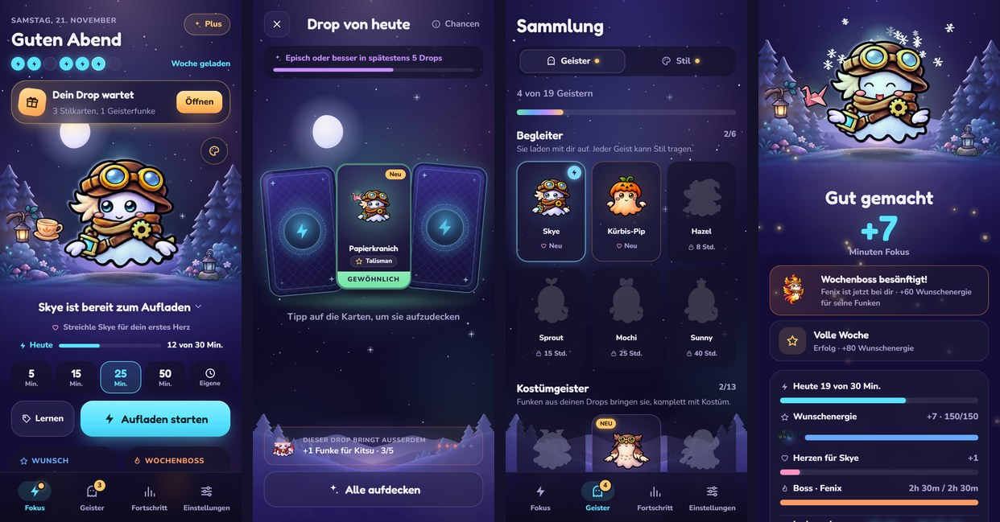

# ChargeGeist

**▶ Jetzt spielen: https://emfau88.github.io/chargegeist-rework/**



Am besten auf dem Handy öffnen oder im Desktop-Browser die Handy-Ansicht nutzen. Die App ist auf Englisch und Deutsch und richtet sich nach der Sprache des Browsers. Umstellen kannst du das unter *Einstellungen*.

ChargeGeist ist ein Fokus-Timer mit Geist. Jede Fokusminute lädt deinen Begleiter auf. Jeden Tag gibt es einen Drop mit drei Stilkarten, von denen du eine behältst. Jeder Drop bringt außerdem einen Geisterfunken. Sind alle Funken da, kommt ein Kostümgeist zu dir, komplett so, wie sein Bausatz ihn zeigt. Keine Werbung, kein Konto, nichts verfällt.

## Schnell testen

**Vollbild:** Auf dem Handy im Browser-Menü „Zum Startbildschirm hinzufügen“ wählen. Von dort startet die App ohne Browserleisten. Auf Android und am Rechner geht es auch direkt über den Schalter **Vollbild** im Entwicklermenü.

Unter **Einstellungen → Entwicklermenü** gibt es Abkürzungen für den Test:

- **Zeit:** Demo-Tempo (1 Sekunde zählt als 1 Minute), 25 Fokusminuten hinzufügen, Tagesziel jetzt erreichen, zum nächsten Tag springen, einen Drop bekommen, den Tages-Drop wieder freigeben, Berührungen für heute zurücksetzen, den Wochenboss besänftigen. Mit „Sofort fertig“ bekommt der Fokus-Screen einen Knopf, der die laufende Sitzung sofort beendet.
- **Geister und Stile:** jeden Geist, jede Aura, jeden Schimmer und jeden Talisman einzeln geben oder nehmen, oder alles auf einmal freischalten.
- **Werte:** einen Geisterfunken, 50 Wunschenergie oder 10 Herzen hinzufügen. **Plus aktiv** schaltet die Plus-Inhalte frei, der Kauf ist im Prototyp nur simuliert.
- **Aussehen:** die Tageszeit des Himmels festlegen, alle paar Sekunden eine Einlage des Geists zeigen, Vollbild.
- **Neu starten:** den Einstieg noch einmal zeigen oder alles zurücksetzen.

Der Spielstand liegt nur im Browser (localStorage).

## Was drin ist

- **Einstieg in einem Schritt:** Der erste Screen hat eine Aufgabe: den Geist wählen, mit dem du beginnst. Oben steht klein der Name der App und die Frage „Wähl deinen Begleiter“, in der Mitte der gewählte Geist groß auf der Lichtung, darunter die drei zur Wahl als runde Porträts. Ein Tipp auf ein Porträt holt diesen Geist auf die Lichtung, und sein Spruch darunter zeigt, wie er ist. Mit „Mit Skye starten“ ist der Einstieg fertig: Der erste Drop öffnet sich als Willkommensgeschenk, sein Stil geht direkt an, danach gehört dir die App. Themen und Tagesziel haben Startwerte und stehen in den Einstellungen. Der Screen öffnet mit einem kurzen Auftritt: Die Lichtung liegt dunkel, die Laternen gehen an, der Geist schwebt herein, dann folgen Frage, Auswahl und Knopf. Ein Tipp überspringt ihn, und bei „Bewegung reduzieren“ steht das fertige Bild sofort da.
- **Fokus-Timer:** 5 bis 180 Minuten, Pause, Tags, ruhige Hintergrundgeräusche, Pausenvorschlag danach. Das Ergebnis baut sich nach der Sitzung Zeile für Zeile auf, ein erreichtes Tagesziel bekommt eine eigene Zeile, und ein Tipp überspringt den Ablauf.
- **6 Begleiter:** Skye, Kürbis-Pip oder Hazel begleiten dich von Anfang an. Die anderen fünf kommen nach 3, 8, 15, 25 und 40 Fokusstunden dazu. Die Startgeister der ersten Fassung (Volti, Ember, Luna) sind vorerst abgeschaltet; wer sie in einem alten Spielstand hatte, bekommt Skye an ihre Stelle, und ihre Bindung bleibt für später aufgehoben.
- **13 Kostümgeister**, zum Beispiel Ronin, Professor Huhu und Kitsu, dazu Gewitterwolke Nimbus, Kaktus Piks, Drache Jade, Laternenqualle Nori, Phönix Fenix und Mondhirsch Elara. Sie kommen komplett mit Kostüm, sobald sie genug Geisterfunken haben (3 oder 5, je nach Seltenheit). Du wählst selbst, welchen Geist du gerade auflädst.
- **Stil statt Verkleidung:** 10 Auren (Partikel um den Geist), 9 Schimmer (die Farbe von Leuchten, Ladung und Funken) und 10 Talismane (ein kleiner Glücksbringer, der neben dem Geist schwebt). Jeder Geist trägt pro Art einen Stil, und die Form der Geister bleibt immer unverändert.
- **Tagesdrop:** 3 Stilkarten aufdecken, 1 behalten, dazu ein Geisterfunke. Rahmen und Fußband jeder Karte zeigen ihre Seltenheit, und bei einer epischen oder mythischen Karte dunkelt der Bildschirm ab. Auf hohen Bildschirmen steht die gewählte Karte danach groß über den beiden anderen. Die Chancen stehen offen in der App, und nach spätestens 10 Drops kommt etwas Episches oder Besseres. Doppelte Stile und Funken für schon volle Geister werden zu Wunschenergie.
- **Wunsch:** Jede Fokusminute bringt Wunschenergie. Damit holst du dir gezielt einen Stil.
- **Ladewoche und Wochenboss:** 5 aktive Tage pro Woche bringen einen Bonus-Drop. Wer das Wochenziel schafft, beruhigt den Boss, und der kommt zu dir. Ein verpasster Tag setzt nichts zurück.
- **Anfassen:** Tippen, Streicheln, Halten und Kitzeln. Gestreichelt schließt der Geist genießerisch die Augen und summt, gehalten wird er zusammengedrückt, gekitzelt kichert er und schlägt einen Salto. Senkrechtes Wischen scrollt weiter die Seite.
- **Bindung pro Geist:** Gemeinsame Fokusminuten (1 Herz pro 5 Minuten) und die Gesten (je 1 Herz am Tag) füllen die Bindung. Bei 10, 40, 100 und 250 Herzen steigt sie: Vertraut (er begrüßt dich mit seinem Spruch), Freund (er umarmt dich nach langem Streicheln), Bester Freund (Halten wird zum High-Five) und Seelenverwandt (goldener Rahmen). Herzen und Stufen sinken nie.
- **Lebendiger Himmel:** Der Standard-Himmel folgt der Tageszeit, Nebelschleier ziehen langsam, ab und zu fällt eine Sternschnuppe. Darunter liegt eine gemalte Landschaft in drei Ebenen: ferne Berge, Hügel und vorn eine Lichtung zwischen Tannen. Wo ein Geist vor dem offenen Himmel schwebt (Start, Fokus, Abschluss, Drop, Einstieg), liegt die Lichtung genau unter seinem Schatten; beim Scrollen geht sie mit, und die Hügel dahinter bleiben etwas zurück. Auf Screens ohne Geist sinkt die Lichtung weg, und nur die Hügel stehen ruhig hinter Karten und Knöpfen. Zwei Laternen zeigen den Tag: Die erste brennt, sobald du heute fokussiert hast, die zweite, wenn das Tagesziel erreicht ist. Sonne und Mond gehen hinter dem Land auf und unter, und der Mond zeigt die Phase des echten. Scrollst du, ziehen sie sich zurück, damit sie nie hinter einer Textzeile liegen. Die Geister nehmen einen Hauch dieser Farbe an, und ihr Saum lässt die Landschaft ein wenig durchscheinen; um ihre Kontur liegt kein Licht. Im Fokus atmet ein Schein in der Farbe des Geists, ein wartender Drop schimmert golden, und nach einer Sitzung regnet es Funken. Die Bewegung ist abschaltbar und bei „Bewegung reduzieren“ aus.
- **Erfolge** mit Wunschenergie als Belohnung, dazu Statistiken und eine Monatskarte zum Teilen.
- **Plus (einmalig):** Hintergründe, Klangwelten, ausführliche Statistiken und der Unterstützer-Schimmer Herzlicht. Plus verkauft keine Drops, Geister oder Tempo.

Die Geister sind animierte Rigs aus Einzelteilen und werden mit WebGL gerendert. Sie atmen, blinzeln, jubeln und reagieren auf Gesten. Die Augen bestehen aus Ebenen: Die Iris wandert mit dem Blick im Auge, die Glanzpunkte bleiben fast stehen, und Lider schließen sich, statt das Auge zu stauchen. In Ruhe macht der Blick kleine Sprünge, folgt dem Finger und geht ab und zu zum Startknopf oder zum wartenden Drop. Ab und zu macht ein Geist von selbst etwas: Er schaut zum Mond, stupst seinen Talisman an, streckt sich, dreht sich einmal oder gähnt, wenn es spät ist. Beim Start einer Sitzung nickt er, beim erreichten Tagesziel ist er stolz, und bei voller Ladung steigen Funken von seinem Büschel. Im Fokus bleibt er ruhig. Töne entstehen im Browser, ohne Audiodateien. Auren laufen als leichte SVG-Partikel, der Talisman folgt dem Geist mit etwas Verzögerung und weicht im Fokus dem Ladering aus.

## Lokal starten

```bash
cd app
npm install
npm run dev        # http://localhost:5173
npm test           # Tests der Rechenregeln und des Spielstands
npm run flow       # ein Durchlauf durch die App mit Prüfungen (der Dev-Server muss laufen)
npm run check      # alles vor einem Commit: Typprüfung, Tests, Durchlauf; bricht beim ersten Fehler ab
npm run build      # Produktions-Build nach app/dist
```

`npm run flow` geht den Weg eines Nutzers: Geist wählen, Geschenk öffnen oder liegen lassen, Sitzung starten, pausieren, neu laden, abschließen, Drop vertagen. Dazu prüft er zwei gleichzeitig offene Instanzen und einen Spielstand aus der Zeit vor den neuen Startgeistern.

Drei Regeln, auf die sich der Spielstand verlässt:

- **Eine Sitzung zählt für den Tag, an dem sie endet.** Minuten, Tagesziel und Drop sehen denselben Tag, auch über Mitternacht.
- **Zwei offene Instanzen überschreiben sich nicht.** Jede Instanz übernimmt, was eine andere seither gespeichert hat, bevor sie selbst etwas ändert.
- **Die tägliche Erinnerung gibt es in der Webfassung nicht.** Eine Webseite kann ohne eigenen Server nicht täglich zu einer Uhrzeit melden; der Schalter erscheint erst in der Android-App (`dailyReminderSupported` in `app/src/platform/device.ts`).

Jeder Push auf `main` baut die App und veröffentlicht sie über GitHub Actions auf GitHub Pages (`.github/workflows/pages.yml`).

## Android-App

Die Android-App ist dieselbe Web-App, mit [Capacitor](https://capacitorjs.com) verpackt (`app/android`, Konfiguration in `app/capacitor.config.json`). Sie läuft ohne Netz: Alles liegt in der App. Sie gehört zum Store-Eintrag der früheren ChargeGeist-App (`com.energycrafted.chargegeist`).

```bash
cd app
npm run android                              # Web-App als Release bauen und ins Android-Projekt kopieren
cd android
./gradlew assembleDebug                      # APK zum Testen: app/build/outputs/apk/debug/app-debug.apk
./gradlew bundleRelease                      # Bundle für den Play Store: app/build/outputs/bundle/release/app-release.aab
```

Gradle braucht Java 21 (zum Beispiel das von Android Studio: `JAVA_HOME` auf dessen `jbr`-Ordner setzen) und das Android-SDK (`sdk.dir` in `android/local.properties`).

**Was die Release-Fassung anders macht** (`npm run android` baut mit `--mode android`, siehe `app/.env.android` und `src/platform/build.ts`):

- Kein Entwicklermenü, kein Debug-Zugang (`window.__cg`), kein simulierter Kauf.
- Plus wird weder angeboten noch gezeigt, bis es als Kaufartikel in Google Play existiert und der Kauf über Play Billing läuft (`PLUS_FOR_SALE`).

**Was nur die Android-App kann** (`src/platform/device.ts`, `NATIVE`):

- Eine Mitteilung, wenn eine Sitzung endet, während das Handy gesperrt ist oder die App im Hintergrund liegt. Die erste Sitzung fragt nach der Erlaubnis; der Schalter steht in den Einstellungen.
- Die Zurück-Geste: Sie schließt, was oben liegt, führt dann zum ersten Tab und von dort zum Startbildschirm.
- Teilen der Monatskarte über das Teilen-Blatt von Android.

**Signieren:** Der Upload-Schlüssel liegt nicht im Repository. `android/key.properties` (wie im alten Projekt: `keyAlias`, `keyPassword`, `storeFile`, `storePassword`) wird von Git ignoriert; ohne diese Datei entsteht ein unsigniertes Bundle. Versionsnummer und `versionCode` stehen in `android/app/build.gradle`.

**Gerätetests** (`app/tools/android_test.mjs`, brauchen einen Emulator oder ein Handy mit installierter Debug-APK): `node tools/android_test.mjs fresh <apk>` prüft die frische Installation im Flugmodus, `lock`, `sleep`, `home` und `pause` je eine echte Fünf-Minuten-Sitzung, `back` die Zurück-Geste. Das App-Icon entsteht mit `python -I tools/android_icon.py .` aus den Icons der Web-App.

## Aufbau

| Ordner | Inhalt |
| --- | --- |
| `app/` | Die Web-App (Vite, Preact, TypeScript) |
| `app/src/rig/` | Geister-Rig: WebGL-Renderer, Animation, Talisman, Gesten-Erkennung, Blick und Lider (`gaze.ts`), Einlagen und Reaktionen (`acts.ts`) |
| `app/src/fx/` | Auren (Partikel), Schimmer (Farben) und das Licht der Szene |
| `app/src/screens/` | Die Screens, darunter das Entwicklermenü (`DevMenu.tsx`) |
| `app/src/state/` | Spielstand und alle Aktionen |
| `app/src/logic/` | Drops, Fortschritt, Boss, Erfolge, Bindung, Tageszeit des Himmels |
| `app/tools/` | Import der Bausätze und Talismane, Trennen der Augen in Ebenen, App-Icon, Screenshot-Skripte |
| `docs/` | Bilder für dieses README |
| `rig_input/` | Die Bausatz-Bögen als Vorlage, die zweite Generation in `rig_input/neu/`, die gemalte Szene in `rig_input/szene/` |
| `rig_parts/` | Die daraus geschnittenen Einzelteile |
| `rig_tools/` | Python-Werkzeuge zum Schneiden und Prüfen der Teile |

Es gibt zwei Generationen von Bausätzen. Die erste zeigt den Körper mit Kostüm, aber ohne Gesicht; Arme, Augen, Münder und Wangen liegen einzeln daneben. Die zweite (Wolke, Kaktus, Drache, Qualle, Phönix, Mondhirsch) zeigt die fertige Figur mit gemaltem Gesicht. Bei ihr ist die fertige Figur der Körper: `build_new.py` rechnet Augen und Mund wieder heraus, die Wangen und schon erhobene Arme bleiben im Bild. So sehen diese Geister genau aus wie auf ihrem Bogen. Der Preis dafür: Lose Arme hat davon nur Nimbus. Bei Kaktus, Drache und Qualle sind die beweglichen Teile aus der Figur geschnitten (`split_arms` in `build_new.py`, Angaben unter `ARMS`): beim Kaktus die erhobenen Arme, beim Drachen die Flügel, bei der Qualle die Flossen und die Laterne an ihrem Stiel. Ein Teil mit eigener Kontur wird an dieser Kontur gefunden; die Flossen der Qualle wachsen ohne Kontur aus der Glocke und werden mit weichem Übergang geschnitten. Liegt ein Teil vor der Figur, wird nachgemalt, was es verdeckt hat. Liegt es dahinter, behält die Figur ihre Kontur, und das Teil bekommt unter ihr einen verdeckten Ansatz, damit beim Drehen keine Lücke aufgeht. Jedes Teil dreht sich dann an einem Gelenk wie ein loser Arm, nur um einen Teil des Wegs und in engen Grenzen; die Laterne schwingt wie ein Büschel und leuchtet mit der Ladung. Phönix und Mondhirsch haben ein eigenes, größeres Bild (`rig_input/neu/fenix_teile.png` und `elara_teile.png`, in `build_new.py` unter `SHEETS`): die Figur ohne Gesicht, ohne Flügel und ohne Ohren, daneben die Flügel und Ohren einzeln und vollständig. Die Teile werden gedreht, verkleinert und an ihr Gelenk gesetzt; sie liegen vor der Figur. Die gemalten Wangen werden herausgeschnitten und gehören bei diesen beiden zum Gesicht: Sie gehen mit dem Blick mit. Augen und Münder kommen weiter vom alten Bogen, auf die Größe der neuen Figur gebracht. Das Rig kann außerdem Teile des Körperbilds an einem Gelenk biegen (`limbs` in `kit_rigs.py`); das nutzt zurzeit kein Geist.

Neue Bausätze übernehmen (aus dem Ordner `chargegeist_rework`):

```bash
# nur für Bögen der zweiten Generation: Teile schneiden, dann die Körper bauen
python -I rig_tools/extract_new.py rig_input/neu rig_parts/kits
python -I rig_tools/build_new.py rig_parts/kits
# alle Bausätze in die App bringen (Maße stehen in rig_tools/kit_rigs.py)
python -I app/tools/import_kits.py rig_parts/kits rig_tools rig_parts app
# danach die Augen in Ebenen trennen (Hintergrund, Iris, Rand, Glanz)
python -I app/tools/split_eyes.py app all
```

Die gemalte Szene neu einlesen (Ebenen `far`, `mid`, `ground` und der Requisiten-Bogen in `rig_input/szene/`, Vorlage mit den Zonen: `vorlage_szene.png`):

```bash
python -I rig_tools/build_scene.py rig_input/szene app
```

App-Icon neu bauen (es zeigt den ersten Startgeist, so wie die App ihn zeichnet; der Dev-Server muss laufen):

```bash
node app/tools/portrait.mjs aviator portrait.png 1024
python -I app/tools/make_icon.py portrait.png app 7fd8ff
```

Talismane neu schneiden (aus demselben Ordner):

```bash
python -I app/tools/import_charms.py rig_input/talismane_v1.png app
```
